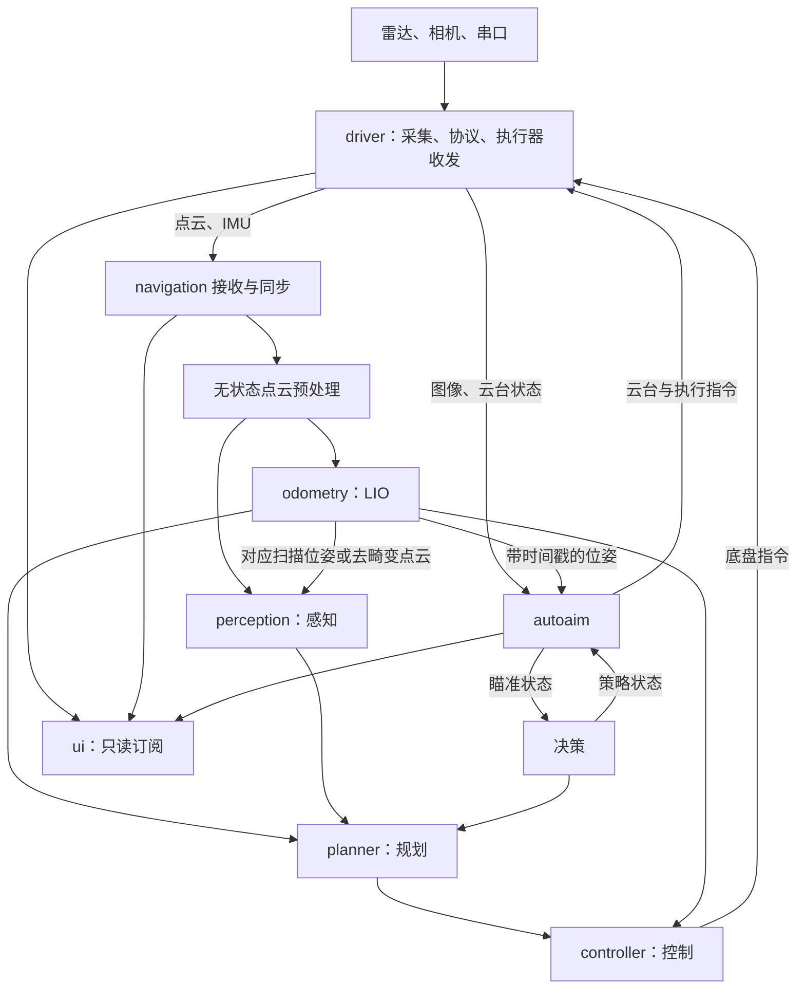

# pure-nav 数据通信与传感器环形缓冲设计

> 状态：设计建议，尚未实现。日期：2026-11-03。
> 依据：当前项目的 shm 封装、Livox 驱动、Super-LIO 与 M-detector 参考代码。
> 本文细化通信方案；与 ARCHITECTURE.md 不一致的地方在文中明确说明，不代表业务代码已经变更。

## 1. 方案结论

可以给传感器数据设计环形缓冲，但应区分三个用途：

1. **跨进程广播**：继续用 iceoryx 的共享内存块池与每订阅者队列，不再手写跨进程大数组和读写游标。
2. **进程内多线程预处理**：用预分配帧池保存大数据，环形队列传递只读帧句柄；不同模块各有自己的消费队列。
3. **按时间同步**：IMU、位姿、云台状态采用小消息时间历史环，按时间区间或插值查询，不按“最新值”配传感器帧。

第一版允许从共享内存到本地帧池复制一次，换取明确的生命周期和资源隔离；完成性能测量后，再决定是否增加跨线程共享内存样本租约。

不要让多个算法线程同时 pop 同一个队列来实现广播：这样一帧只会被其中一个线程取走，其他模块会漏帧。

## 2. 当前基础与缺口

| 现有能力 | 当前限制 | 设计动作 |
|---|---|---|
| `ShmPublisher<T>` / `ShmSubscriber<T>` | 订阅回调返回后样本失效 | 接收线程在回调内完成本地复制 |
| `FixedVector<T,N>` | 只提供容器，无统一业务消息 | 定义统一消息、主题、单位和坐标系 |
| Livox 两条消费线程 | 输出点云含 `std::vector`，不可直接跨进程 | 增加驱动数据到共享内存消息的适配层 |
| `BlockingQueue<T>` | 适合任务消费，不提供广播或历史查询 | 保留用于驱动包队列，新增通用帧池和历史环 |
| `waitForData()` | 200 微秒间隔轮询，没有 WaitSet 接口 | 第一阶段可沿用，后续扩展事件等待 |
| 点云只有帧首时间 | 无逐点时间，未对外保留时间类型 | 补帧起止时间、逐点时间偏移与时钟标识 |
| Super-LIO / M-detector | 分别依赖 ROS 2 / ROS 1，未接入 | 提取算法接口，消息适配留在应用层 |

现有 `BlockingQueue` 用互斥锁保护操作。“不等待空位”不等于无锁或严格无阻塞，不应据此宣称已有硬实时保证。

## 3. 进程与模块通信

四个业务进程保持不变，另有一个 `iox-roudi` 守护进程。`common` 是公共库，`core` 是装配接口，不单独作为进程或话题节点。



无状态的格式整理、无效点标记可以并行于定位；**M-detector 的动态判断需要对应位姿，不能完全独立于定位运行**。若沿用其参考入口，还需提供与位姿匹配的去畸变点云。

这里细化了原架构中“感知与定位并行”的说法：并行的是可独立执行的预处理，涉及运动补偿或世界坐标判断的阶段必须等待所需估计结果。

## 4. 主题与数据语义

当前 `ShmTopic::fromString()` 要求恰好三段。统一采用 `领域/对象/数据`，例如 `sensor/lidar/points`，不用只有两段的 `state/pose`。

表中队列深度是初始建议，表示每个订阅者各自的容量；频率是调度目标，需按硬件和算法耗时校准。

| 主题 | 唯一发布模块 | 订阅模块 | 深度与语义 |
|---|---|---|---|
| `sensor/lidar/points` | driver 雷达线程 | navigation 接收线程、ui | navigation 3 帧；ui 1 帧 |
| `sensor/lidar/imu` | driver IMU 线程 | navigation IMU 接收线程 | 64 条，及时排入时间历史环 |
| `sensor/camera/image` | driver 相机线程 | autoaim 图像接收线程 | 2 帧，过期帧可丢 |
| `sensor/referee/state` | driver 串口线程 | 决策、ui | 1，最新状态 |
| `sensor/gimbal/state` | driver 串口线程 | autoaim、ui | autoaim 64，进入时间历史环；ui 1 |
| `state/odometry/pose` | odometry | 规划、控制、autoaim、ui | 通常 1；需历史的接收方单独设置容量 |
| `state/perception/obstacles` | perception | 规划、决策、ui | 1，带有效期限 |
| `state/decision/mode` | 决策 | 规划、autoaim、ui | 1，最新策略 |
| `state/planner/path` | planner | controller、ui | 1，最新有效路径 |
| `state/autoaim/status` | autoaim | 决策、ui | 1，最新状态 |
| `cmd/chassis/setpoint` | controller | driver | 1，最新指令 |
| `cmd/gimbal/setpoint` | autoaim | driver | 1，最新指令 |
| `cmd/fire/request` | autoaim | driver | 有确认语义的离散请求，见第 10 节 |
| `debug/camera/preview` | autoaim | ui | 1，降采样预览 |
| `debug/lidar/preview` | navigation | ui | 1，可选的降采样点云 |
| `status/<进程名>/health` | 各进程健康汇聚线程 | ui、运行管理程序 | 1，心跳和错误计数 |

这是拟定的新主题契约，尚未有业务发布者；落地时同步更新 ARCHITECTURE.md。点云和图像不保留发布历史，小状态可保留 1 条；晚加入者收到历史状态后仍必须检查有效期。

同进程中，模块输出先发布 shm，规划、控制、ui 等各自订阅，复用统一接口；高频算法中间量保留在本地。去畸变整帧、任务块等内部数据先走本地帧池，确有跨进程需求再增加主题。

`sim` 作为离线输入适配器，可以复用传感器主题，但必须在独立运行环境或停止真实 driver 后发布，禁止仿真和真实硬件同时成为同一主题的发布者。

## 5. 统一消息设计

建议在 `src/common/shm/include/shm_msgs.hpp` 和 `shm_topics.hpp` 中集中定义。以下是拟定字段，不是已经存在的接口。

| 公共消息头字段 | 含义 |
|---|---|
| `layout_version` | 消息布局版本；布局不兼容时换版本主题并整体升级 |
| `source_id`、`session_id` | 传感器来源与本次发布会话；进程重启后更换会话 |
| `seq` | 会话内递增的 64 位序号，不复用 Livox 的 8 位帧号 |
| `t_sensor_ns`、`clock_domain` | 原始采样时间与所属时钟域 |
| `t_sample_mono_ns` | 映射到本机统一单调时钟的采样时间 |
| `t_receive_mono_ns`、`t_publish_mono_ns` | 主机接收与发布时刻，用于测量延迟 |
| `frame_id`、`calibration_version` | 坐标系标识和标定版本 |
| `flags` | 同步有效、部分帧、超容量、数据缺口等标志 |

所有跨进程消息采用固定容量、可平凡复制的结构，禁止指针、`std::vector`、`std::string`、`cv::Mat`、PCL 点云指针和动态 Eigen 对象。可平凡复制检查无法识别结构内部的裸指针，还要人工检查成员。

各消息的必要内容：

- **点云**：扫描起止时间、点数、每点的 x/y/z、强度、标签、相对扫描开始的时间偏移。第一版可按 20000 点设计，但必须实测最大帧点数；超容时丢弃并计数，或显式标记截断，不能静默生成“完整帧”。
- **IMU**：加速度 m/s²、角速度 rad/s，保留原始单位或标定信息用于诊断。
- **图像**：宽、高、步长、像素格式、曝光起止时间、有效字节数、固定容量字节数组；检查 `stride × height` 不超过容量。
- **位姿**：估计时刻、位置、四元数、速度、协方差或质量标志、对应 `scan_seq`。
- **障碍物与路径**：坐标系、源扫描或规划序号、有效期限、固定容量元素列表。
- **控制指令**：生成时间、有效期限、指令序号、发布会话；driver 检查新鲜度和合法来源。

约定 SI 单位，四元数顺序明确为 `[w,x,y,z]`，变换 `T_a_b` 表示从 b 系到 a 系。坐标枚举及轴向集中定义，不能在不同模块靠字符串猜测。

共享内存按最大容量分配，实际点数或图像字节数变少不会缩小 chunk。容量设计需按 `sizeof(消息)` 和实际对齐验证，不能只按有效数据量预算。

当前 Livox `PointXYZI` 没有时间偏移，`FrameAssembler` 也没有对外保留完整时间信息。接入 LIO 前必须根据当前 SDK 协议核对逐点时间恢复规则；不能未经核实，把包内 `time_interval` 直接解释为相邻点间隔。

## 6. 大数据环形缓冲：帧池与独立队列

### 6.1 数据流

```text
SDK 回调 → 驱动原始包队列 → 组帧/解码 → shm 发布
                                              ↓
                                 navigation 点云接收线程
                                              ↓ 回调内复制一次
                                  本地预分配点云帧池
                                              ↓ 只传只读句柄
                                  有界预处理任务环形队列
                                              ↓
                                    固定数量工作线程
                                              ↓
                                结果汇聚与按序提交线程
                                     ↙                 ↘
                             LIO 独立队列       感知独立队列
```

定位和感知的队列存放同一帧的只读句柄，数据不重复复制。两者各自消费；后续有写操作的算法必须使用自己的输出帧或工作区，不能修改共享原始帧。

### 6.2 槽位与生命周期

本地帧池启动时分配 N 个固定容量槽位，循环选择空闲槽位：

```text
FREE → FILLING → READY → 最后一个句柄释放 → FREE
```

每个槽位包含代数、消息头、有效长度、数据区和受保护的引用计数。句柄保存槽位索引与代数；代数用于拒绝复用后的旧句柄，引用计数负责禁止提前复用。

第一版用短临界区互斥锁管理槽位与引用，不手写复杂无锁算法。线程通过有界队列交接句柄，写入完成后才能入队，消费者只读。锁内只做元数据操作，不做整帧复制或算法计算。

关键约束：

1. 只允许覆盖 **FREE** 槽位，不能覆盖任何线程仍持有的帧。
2. 队列丢弃待处理旧任务时，同步释放其句柄；正在执行的任务不能强制回收。
3. 帧池耗尽时计数并丢弃本次新帧，接收线程继续排空上游；不能等待慢算法释放槽位。
4. 一个队列淘汰旧句柄，不会使其他模块持有的同一帧失效。
5. 池销毁前必须停止接收、结束任务并释放全部句柄；禁止带着旧句柄重置池。

建议自定义进程内 `FrameHandle` 和预分配控制信息。普通 `shared_ptr` 可用于原型，但控制块可能动态分配，不应声称完全没有运行期堆分配。句柄和引用计数都不放入跨进程消息。

### 6.3 三种并发方式

| 需求 | 正确方式 | 约束 |
|---|---|---|
| 定位、感知都读取同一帧 | 每模块独立队列，共享只读帧句柄 | 广播语义 |
| 多线程处理不同帧 | 一个任务队列，多个工作线程竞争任务 | 只用于无跨帧状态的处理 |
| 多线程处理同一帧 | 一帧拆成互不重叠的区间任务 | 完成屏障后再交给下游 |

同帧并行时，先固定输出大小，各线程只写自己的区间；禁止并行 `push_back`。需要压缩有效点时，每线程输出到独立预分配分区，汇聚线程按固定顺序合并。使用代数和任务完成数确保失败或超时任务结束前不复用输出槽位。

跨帧并行可能让第 12 帧先于第 11 帧完成。汇聚线程采用有界重排表；超时可放弃缺失帧并记录缺口，迟到结果丢弃，**已经提交 12 后不能再向状态估计提交 11**。

LIO 滤波状态、地图更新和 M-detector 历史状态各有单一所有线程；只能并行它们明确可拆分的内部计算，不能把有状态 `process()` 随意丢进多帧线程池。

### 6.4 容量初值

| 缓冲 | 初始容量 | 溢出处理 |
|---|---|---|
| driver 原始点云包队列 | 沿用 512 包 | 丢旧包并统计；输出部分帧标志 |
| navigation 点云共享内存订阅队列 | 3 帧 | 丢最旧的未取样本 |
| navigation 本地点云帧池 | 12 帧 | 无空闲槽位则丢新帧并告警 |
| 无状态预处理工作线程 | 2 个 | 先限制并发，实测后调整 |
| 定位、感知各自待处理队列 | 各 2 帧 | 可丢未开始的旧帧，保留缺口信息 |
| 图像本地帧池 | 4–6 帧 | 优先淘汰未开始的旧图像任务 |
| ui 订阅队列 | 1 帧 | 最新值，不积压 |

12 帧是资源起点，不是吞吐保证。按“写入中 + 排队 + 执行中 + 乱序完成 + 下游持有 + 余量”的最大在飞帧数重新计算；对共享同一帧的句柄不重复计算本地数据槽位。

若平均处理耗时持续超过输入周期，再大的环形缓冲也只能延迟拥塞。应降采样、减少工作量或降低输入频率，并设最大数据年龄。

## 7. IMU 与状态时间历史环

IMU 是顺序积分输入，不采用图像的“只要最新一条”策略。为 navigation 增加独立 IMU 接收线程，及时复制小消息到预分配历史环。

建议的进程内接口语义：

```text
append(sample)                         按序写入
readAfter(session, seq, limit)          读取后续采样，返回是否发生覆盖缺口
copyRange(t_begin, t_end)               拷贝区间与两端插值所需样本
bracket(t)                             返回包围 t 的两个样本或失败
oldestTime() / newestTime()             检查时间覆盖范围
```

这些接口尚需实现。第一版在短锁内复制到调用方预分配工作区，解锁后计算，不把环内元素指针或引用交给算法。每个读取者独立维护游标，不能让一个读取者删除其他读取者仍需查询的历史。

写指针可以循环覆盖过期小样本；读取时根据会话、序号和最早可用时间检测覆盖。这里允许覆盖，是因为读取方持有的是复制出来的快照，与第 6 节的大帧租约不同。

初始建议：

- IMU 本地历史 1024 条，200 Hz 下约覆盖 5.12 秒；共享内存队列仍用 64 条，它只吸收接收线程短暂停顿。
- 位姿历史按至少 1 秒设计，例如 200 Hz 时保留 256 条；供延迟图像或点云配准。
- 云台状态按至少 1 秒设计，容量根据实际频率配置，不能默认套用 200 Hz。

容量公式：`N ≥ ceil(采样率 × 需要保留的时间窗) + 余量`。时间窗覆盖最大预处理延迟、扫描时长、等待抖动和插值边界。长历史不意味着允许处理几秒前的旧数据。

顺序号缺口、时间倒退或 IMU 采样间隔异常时，向定位报告数据质量错误；是否短时预测、丢弃扫描或重新初始化由状态估计策略决定，不能默默忽略缺口。

## 8. 多传感器时间同步

所有进程在同一主机上使用统一的单调时钟接口，例如 Linux `CLOCK_MONOTONIC`。原始设备时间单独保留，不直接与主机单调时间相减，也不用系统墙钟调整计算控制超时。

为每个设备维护 `t_mono = a × t_sensor + b` 的映射、同步有效标志与误差估计。没有硬件授时时，接收时间只能提供带传输抖动的近似映射；误差超过算法阈值时拒绝融合。设备重启、时间回退或标定变化时清空相应同步缓存。

点云与 IMU 同步流程：

1. 取得点云扫描区间 `[t_begin,t_end]`，检查帧完整性和时间映射有效性。
2. 从 IMU 历史提取覆盖前一次积分边界至 `t_end` 的连续区间，并保留两端插值样本；首次扫描至少覆盖整个扫描区间。
3. IMU 尚未覆盖扫描末端时，设置有界等待期限；到期后报告不同步并丢弃扫描，不无限积压。
4. 定位按时间先后传播、去畸变与更新；输出标注估计时刻和 `scan_seq`。
5. M-detector 使用相同扫描的去畸变结果和对应位姿；不能将历史点云配上刚到的最新位姿。

图像按曝光中点或算法约定时刻查询位姿和云台状态；没有包围样本时只能进行有界外推或拒绝该次融合，并明确标记质量。

无状态预处理可先运行；依赖运动状态的去畸变放在完成同步之后。仅当数学上有等价依据时才允许把某项预处理提前，避免抽样改变 LIO 所需点时序。

## 9. 共享内存生命周期与内存预算

现有 `take(handler)` 中样本只在 handler 内有效。以下做法错误：把 `&msg` 放入任务队列，然后让 handler 返回；工作线程可能读到已经回收的 chunk。

第一版采用：**回调内复制到空闲本地槽位 → 提交只读句柄 → 立即归还共享内存样本**。因此跨进程收发仍利用 iceoryx，共享内存到本地帧池有一次显式拷贝，算法之间不再复制整帧。

若测量确认复制是瓶颈，再新增移动式样本租约：接收线程持有真正的 iceoryx Sample，工作线程借只读视图，最后完成通知回到接收线程释放。订阅对象必须活到全部租约结束；限制每订阅者在持样本数量，并验证当前 iceoryx 的配额与线程约束。该接口当前不存在，不能仅保留裸指针模拟租约。

同一发布样本被多个订阅者引用时，payload 共享一块 chunk；慢消费者可能钉住不同的旧 chunk。内存预算按各档位的**不同在飞块数量**计算，可以用下式做保守上界：

```text
档位块数 ≥ 该档所有发布者历史块
          + 所有订阅者排队与在持块之和
          + 发布端写入中及内部保留块
          + 压测确定的余量
```

这个上界可能重复计算同一块，但不能只取最大队列深度。小消息历史环占用的是本地内存，不会额外长期占用共享内存块。

当前 `config/iceoryx_roudi.toml` 的 `size × count` 合计 **291917824 字节，约 278.4 MiB**，尚未计入管理与对齐开销；文件注释中的“约 254 MB”不准确。

建议按实际传感器重新分档：小状态、点云、灰度图、彩色图分别核算；不要预留未使用的大图像池。2 MB 档可承载适当分辨率灰度图，但同一最大容量消息不能因为有效长度较小就落入较小档位。各档必须能容纳对应 `sizeof(T)`、chunk 头和对齐需求。

ui 先只看深度为 1 的低频预览；回调内复制到自己的本地渲染快照后归还样本。队列深度为 1 仍不能防止渲染线程长期持有样本，因此渲染不得直接占用关键链路租约。

## 10. 调度、超时与故障处理

- 每个发布/订阅对象有唯一所有线程。初始化运行时在主线程串行完成，再创建端口和工作线程。
- 接收线程只做校验、时间标记和搬运；算法不在接收线程执行。IMU 独立接收，避免大帧复制影响顺序采样。
- 后续为 shm 增加 WaitSet 事件等待；事件到来后采用有界批量 drain，避免持续高频数据使其他源饥饿。当前的 200 微秒轮询不是严格唤醒延迟上界。
- 控制按自身周期读取最新有效状态，不等待规划出新路径；规划、决策和 UI 各有独立周期。500 Hz 等目标需通过整机调度压测验证。
- `OUT_OF_CHUNKS`、队列覆盖、同步失败都进入计数和健康状态；采集线程不能等待 UI 或慢算法。
- driver 检查指令有效期限；初始可按 100 ms 无新指令进入安全状态。控制的位姿超时阈值须结合速度和停止距离确定，不能只依赖通信仍有心跳。
- 障碍结果超时意味着信息未知，规划沿用保守地图或降级，不能解释为没有障碍。

**状态与事件分开处理**：速度和姿态目标可以覆盖旧值；一次性动作请求不能仅放入深度为 1 的“最新值邮箱”。若保留 `cmd/fire/request` 等离散指令，需要会话内唯一 `request_id`、有效期限、确认消息和 driver 去重；重发只发生在有效期内，不把发布成功当成执行成功。driver 重启后要求重新建立会话，旧动作不得回放。

保留 autoaim 作为自身指令的唯一发布者，决策提供带期限的策略状态。决策与 autoaim 的状态反馈允许异步循环，但双方不得同步等待对方“本轮结果”；输入未就绪或过期时进入确定的保守状态。因此不宣称整个业务图是无环图。

启动顺序：RouDi → driver → navigation / autoaim → ui。算法只在输入时间覆盖和状态就绪后进入正常模式，不以启动顺序推断数据已经有效。

退出顺序：先停止产生新任务，唤醒并停止接收，取消待处理任务，等待正在执行的任务结束，释放本地句柄或共享内存租约，销毁端口，最后退出运行时。运行中任务不能在仍访问数据时被强制回收。

第一版将 RouDi 故障视为通信会话失效，由运行管理程序停止并重启依赖它的业务进程；硬件端独立通信看门狗负责失联兜底。当前封装没有透明重连能力，不承诺仅重启 RouDi 后旧端口自动恢复。

## 11. 建议落地顺序

| 阶段 | 需要新增或调整 | 验收目标 |
|---|---|---|
| 1：消息契约 | `shm_msgs.hpp`、`shm_topics.hpp`、时间与坐标约定 | 固定布局检查、容量和主题三段校验 |
| 2：驱动发布 | driver 入口、消息适配、逐点时间与帧信息 | 雷达回调到跨进程订阅可跑通 |
| 3：本地缓冲 | `common` 下的帧池、句柄环形队列、时间历史环 | 多消费者独立读、满载不覆盖在用帧 |
| 4：预处理 | 有界任务队列、固定工作线程、按序汇聚 | 同帧分块和跨帧乱序都能正确处理 |
| 5：算法接入 | Super-LIO / M-detector 去 ROS 化与同步适配 | 位姿、障碍结果的扫描号与时间一致 |
| 6：业务闭环 | 规划、控制、自瞄、UI、健康状态与看门狗 | 慢消费者和进程故障可控降级 |
| 7：性能优化 | WaitSet、按测量决定是否增加样本租约 | 对比复制成本、延迟分位数与资源占用 |

文件建议放在 `src/common/buffer/include/` 与 `src/common/buffer/src/`，目标统一登记在 `src/common/CMakeLists.txt`。环形缓冲应成为公共基础设施，避免导航模块依赖 Livox 驱动的私有实现。

必要验证包括：

1. 两个消费者读取同一输入；一个休眠时另一个仍能继续，丢帧分别统计。
2. 环形队列回绕、帧池耗尽、旧句柄和关闭唤醒；持有中的帧内容保持不变。
3. 工作线程乱序完成、任务失败和退出；没有结果倒序提交或提前复用。
4. IMU 丢样、时间回退、设备重启、区间覆盖不足；不能无提示继续融合。
5. 跨进程发布订阅、重启会话切换、共享内存池耗尽、指令超时与请求去重。
6. 人为卡住 UI 或感知，测量输入年龄、队列水位、丢包、同步失败、内存占用和端到端延迟 p50/p95/p99；使用线程检测工具检查本地缓冲竞争。

第一阶段的可交付链路应是：**Livox → shm → navigation 本地环形帧池 → 并行预处理 → 时间同步 → 单线程状态估计 → shm 位姿输出 → ui**。在这条链路测量稳定后，再接入其他业务模块。
