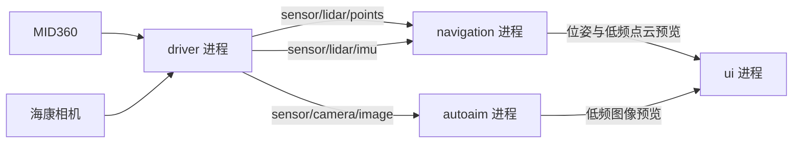

# 从传感器到预处理：数据结构与通信设计

> 核对日期：2026-11-03。本文先记录代码事实，再给出待实现设计。
> 与 [数据通信设计](DATA_COMMUNICATION_DESIGN.md) 配合阅读；本文补充传感器字段、实际调用链和优先修正项。

## 1. 当前实现边界

| 环节 | 当前状态 | 入口 |
|---|---|---|
| Livox MID360 | 已有 SDK 封装、解码、组帧、点云与惯性测量单元（IMU）回调 | `src/driver/livox_driver/` |
| 海康工业相机 | 本仓库没有驱动、图像类型或发布适配器 | `src/driver/CMakeLists.txt` 只接入 Livox |
| 进程间通信 | 已有 iceoryx 发布订阅封装与定容容器 | `src/common/shm/` |
| driver → navigation / autoaim | 尚未装配传感器发布和消费链路 | `src/app/` |
| 多进程应用 | 架构设计已有，当前 CMake 只构建 `pure_nav.cpp` 的 Hello 入口 | `src/app/CMakeLists.txt` |

`src/app/driver.cpp` 是未纳入构建的旧示例，引用的 `SharedMemory` 和头文件路径与当前接口不符，不能当作已经工作的驱动进程。

海康部分以下依据本机安装的厂商头文件 `/opt/MVS/include/CameraParams.h`、`MvCameraControl.h`，不代表已接入本仓库。实际相机型号、分辨率、像素格式、帧率和触发方式仍需在接入时确定。

## 2. MID360：线上数据 → 包队列 → 对外数据

### 2.1 SDK 输入是数据包，不是整帧点云

本地 SDK 定义在 `src/thirdparty/Livox-SDK2/include/livox_lidar_def.h`：

```text
LivoxLidarEthernetPacket
├─ version / length / crc32
├─ time_interval: uint16，单位 100 ns
├─ dot_num: uint16，本包采样数
├─ udp_cnt: uint16，包计数
├─ frame_cnt: uint8，设备帧计数
├─ data_type / time_type: uint8
├─ timestamp[8]，设备时间
└─ data[]，由 data_type 决定解释方式
```

默认高精度直角坐标点 `LivoxLidarCartesianHighRawPoint` 是紧凑的 **14 字节**：三个 `int32_t` 坐标（mm），一个 `uint8_t reflectivity`，一个 `uint8_t tag`。这与算法侧浮点结构的内存布局不同，不能直接整块当作 `PointXYZI` 使用。

驱动先复制成自有 `RawPacket`：保存 handle、设备时间、包间隔、点数、包计数、类型、时间类型，以及固定 `payload[2048]`。这里只复制有效载荷，不保留原始包的全部协议字段。

### 2.2 点云对外是自定义 C++ 结构，不是 PCL 或 ROS 消息

定义：`src/driver/livox_driver/include/livox_driver/livox_types.hpp`。

```cpp
// 现有字段示意，省略构造函数和方法。
struct PointXYZI {
    float x, y, z;       // m，驱动没有在这里变换到车体或世界坐标系
    float intensity;     // 原始反射率转换成 float，范围 0~255
    uint8_t tag;
};

struct PointCloudFrame {
    uint32_t handle;
    uint32_t frame_index;
    uint64_t timestamp_ns;
    uint32_t received_packets;
    uint32_t expected_packets;
    bool complete;
    uint8_t dev_type;
    uint8_t data_type;
    std::vector<PointXYZI> points;
};
```

`timestamp_ns` 实际是**首个收到的包**的设备时间；如果前面的包丢失，它不是完整扫描的真实起始时间。`frame_index` 来自 8 位 `frame_cnt`，不是进程生命周期内单调递增的扫描序号。

`PointXYZI` 在常见 ABI 下为 20 字节，尾部存在对齐填充；2 万点约 400000 字节，仅计算点数组。不能沿用四个 float 的 16 字节点估算本驱动内存。最终以目标平台 `sizeof` 为准。

当前不包含逐点时间、扫描结束时间、坐标系 ID、时间同步质量。`std::vector` 的元素在当前进程堆上，因此 `PointCloudFrame` **不能直接作为共享内存消息**。

`decodePointPacket()` 把 mm 转 m；高精度、低精度、球坐标、双回波各有分支。MID360 优先使用默认高精度直角坐标格式；通用分支不代表每个格式都已在本机型实测。

### 2.3 IMU 对外是一个采样，不是姿态估计

```cpp
// 现有字段示意。
struct ImuSample {
    uint64_t timestamp_ns;
    float acc_x, acc_y, acc_z;
    float gyro_x, gyro_y, gyro_z;
    float raw_acc_x, raw_acc_y, raw_acc_z;
    float raw_gyro_x, raw_gyro_y, raw_gyro_z;
};
```

这是 1 个时间戳加 12 个 float，常见 ABI 为 **56 字节**。默认加速度由 g 乘 `9.80665` 转成 m/s²；角速度保持 rad/s。raw 字段保留设备原值。

没有四元数、姿态、速度、位置或协方差；当前没有进行偏置估计、重力补偿或坐标变换。加速度原始测量不能直接当作世界坐标系线加速度积分。

相较原始包，输出丢失了 `time_type` 和设备身份字段。即使目前每个实例只绑定一台设备，通用消息也应显式携带来源与时钟域。

### 2.4 当前真实线程路径与所有权

```text
SDK 数据接收线程
├─ 点云回调 → 复制 RawPacket → point_queue_（默认 512 包）
│                              ↓
│                        point_thread_
│                        解码 + FrameAssembler
│                              ↓
│                        point_callback_(const PointCloudFrame&)
│                              ↓
│                        点数组 swap 到 latest_frame_
└─ IMU 回调 → 小包解码 → imu_queue_（默认 1024 个采样）
                               ↓
                         imu_thread_
                         latest_imu_ 更新 + imu_callback_
```

注意实现与文件头概述的差别：**IMU 解码实际在 SDK 回调线程完成，独立线程负责分发**。两条用户回调分别阻塞自己的消费线程；点云慢回调仍可能让上游点云包队列溢出。

`latestFrame(out)` 深拷贝整帧，适合预览或调试；`latestImu(out)` 只取最近一条，不能用它轮询获取定位所需的全部惯性采样。回调参数都是借用引用，返回后不应保存其裸指针给异步任务。

### 2.5 在加线程之前优先检查的正确性问题

1. **组帧边界**：当前完全以 `frame_cnt` 变化切帧。厂商协议注明非重复扫描下此字段无效。如果实际设备不递增它，持续来包会一直累积，200 ms 的“没有包”超时也不会触发。必须抓包验证当前模式；建议以设备点时间划分可配置扫描窗口，例如 100 ms，不能只依赖 `frame_cnt`。窗口跨包时需要按点时间拆分；墙钟超时只负责冲刷，不定义正常扫描边界。
2. **逐点时间**：当前转换后丢失。对单回波包、点数 `N > 1`，依据协议可推导 `t_i = t_packet + i × time_interval × 100 ns / (N - 1)`；使用足够宽的整数计算，`N == 1` 使用包时间。回波组合需另核协议，不能直接套用。过滤后应保留原始时间，不能用过滤后下标重新分配。
3. **完整性**：`received_packets >= max(udp_cnt)+1` 只是当前实现的启发式判断。重复包可能掩盖缺口，末尾缺包无法由最大已见序号推断，超时 flush 也没有强制标为不完整。应记录去重、乱序、已知缺口、边界是否可靠；不把 `complete == true` 当作绝对无丢包证明。
4. **容量**：当前逐包执行 `reserve(size + count)`，可能反复扩容搬运；点数组没有固定容量上限。应先确定扫描窗口、点率与余量，预留并复用容量，再设置硬上限和溢出计数。
5. **多采样 IMU 时间**：当前通用解码按 `i × time_interval` 顺延；MID360 正常单采样包不受影响。未来接入多采样包时应单独核实协议含义，不把此算法当作已验证规则。

以上第 1、2、3 项是代码与协议对照得到的风险，尚未通过本机雷达抓包确认。协议依据：[Livox MID360 官方通信协议](https://livox-wiki-cn.readthedocs.io/zh-cn/latest/tutorials/new_product/mid360/livox_eth_protocol_mid360.html)。

## 3. 海康：图像本质是像素缓冲区 + 元数据

### 3.1 厂商结构与项目结构要分开

本机 MVS 头文件中的关键字段如下，省略保留字段与扩展信息：

```text
MV_FRAME_OUT
├─ pBufAddr: unsigned char*，像素缓冲区指针
└─ stFrameInfo: MV_FRAME_OUT_INFO_EX
   ├─ nWidth / nHeight，扩展尺寸 nExtendWidth / nExtendHeight
   ├─ enPixelType，像素格式
   ├─ nFrameNum，设备帧号
   ├─ nDevTimeStampHigh / nDevTimeStampLow，设备时间
   ├─ nHostTimeStamp，SDK 主机时间
   ├─ nFrameLen / nFrameLenEx，有效载荷字节数
   ├─ fExposureTime / fGain
   └─ nLostPacket 等质量信息
```

图像未必是 BGR 三通道：可能是 Mono8、Bayer8、RGB/BGR、10/12 位打包格式等。实际取决于机型及配置；Bayer8 虽然每像素一个字节，也不能作为普通灰度图处理。

建议第一版只接受明确配置的 Mono8 或一种 Bayer8 格式。高位深打包格式应先设计明确的行布局/解包适配，不能按 `width × height × channels` 猜字节数。

### 3.2 明确释放时机

对于 GigE / USB3 Vision 取流，可采用厂商头文件提供的路径：

```text
StartGrabbing
    ↓
GetImageBuffer（有限超时）
    ↓
校验元数据 → 复制/整理有效像素到自有槽位或 shm → 发布
    ↓
FreeImageBuffer（成功取到的每帧均须归还，包括后续校验失败）
```

`MV_FRAME_OUT` 含指针，不能直接跨进程。`cv::Mat(height, width, type, pBufAddr, step)` 只是借用 SDK 像素数据的视图，SDK 缓冲归还后该视图失效；`cv::Mat` 对象本身也不能当作共享内存协议。

项目建议的图像帧包含：消息头、宽、高、`stride_bytes`、像素格式、有效字节数、曝光时间/时间语义、标定版本，以及自有像素存储。算法侧可以临时创建 `cv::Mat` 视图，但其生命期必须被所属帧句柄覆盖。

设备时间高低位可以组合为 `uint64_t`，**单位仍需查询设备时间戳频率**；SDK 的主机时间也不能默认等于 Linux 单调纳秒。曝光开始/结束若无设备依据，应标未知，不从接收时间伪造曝光时刻。

## 4. 共享内存消息：固定容量、有效长度、完整时间语义

沿用现有 `ShmPublisher<T>` / `ShmSubscriber<T>`，新增统一消息契约。下面是待实现的结构关系，不是已经存在的类型：

| 类型 | 建议字段 |
|---|---|
| `SensorHeader` | 布局版本、设备 ID、发布会话 ID、64 位单调序号、坐标系、原始时钟域、原始设备时间、主机接收单调时间、映射后采集时间、同步有效标志与误差 |
| `TimedPoint` | `float x,y,z,intensity`、`uint32_t offset_ns`、`uint8_t tag`、显式保留字节 |
| `PointCloudMsg` | 消息头、扫描起止时刻、包统计、质量标志、`FixedVector<TimedPoint, MaxPoints>` |
| `ImuMsg` | 消息头、三轴加速度和角速度、质量标志；原始值可保留或另走调试流 |
| `ImageMsg` | 消息头、尺寸、行步长、像素格式、有效字节数、曝光元数据、`std::array<uint8_t, MaxImageBytes>` |

各字段单位集中约定。传感器坐标、车体坐标、相机光学坐标分配不同 ID；外参携带标定版本。时间偏移选纳秒时，32 位上限约 4.29 秒，扫描窗口必须小于此范围。

共享内存消息要求无进程私有指针、可平凡复制、发送接收布局一致；`is_trivially_copyable` **不能递归证明没有指针**，还需检查成员。固定宽度类型、明确保留字节与目标平台 `sizeof/alignof` 校验比 `#pragma pack(1)` 更合适，避免让算法每次访问未对齐浮点数。

固定容量消息始终按 `sizeof(T)` 申请内存，不随实际点数缩小。`TimedPoint` 按上述布局常见为 24 字节：2 万点约 480 KB，再加消息头，需实际核对 512 KiB 档位是否容纳。2 万只是容量算例，不能在未测点率前固定为硬件上限。

图像优先规范成单平面非压缩布局，验证行字节数、`stride × height`、有效长度和最大容量；使用宽整数检查乘法溢出。若要保留打包、压缩、多平面或附加 Chunk 数据，应另定义布局，不能混用这一契约。超容量应拒绝并统计，不能依赖 `FixedVector::resize()` 静默截断。

### 4.1 推荐进程与主题



四个业务进程另加 RouDi 守护进程，这是目标装配。先让 `driver → navigation` 两进程链路工作；不必为每个算法单独增加进程。

每个主题唯一发布者，每个消费者独立订阅队列。点云队列可从 3 帧起步，图像 2 帧，IMU 64 条，UI 预览 1 帧；均是起点，不是硬件保证。IMU 队列溢出要明确报告采样缺口，不能按“只要最新”处理。

## 5. 三种缓冲结构，各司其职

### 5.1 已有的包环形队列

`BlockingQueue<T>` 底层是预分配 `std::vector<T>`，维护 `head/tail/size/capacity`，通过取模回绕。互斥锁保护读写，条件变量唤醒消费者。满时默认丢最旧元素，两个 Livox 队列均如此配置。

它是有界消费队列，**已有环形实现**；不是无锁队列，不支持按时间查询，也不提供广播。丢旧元素时生产者也会改 `head`，不能简单去掉锁、换成两个原子游标就声称安全。

### 5.2 大帧用预分配帧池，队列只传句柄

```text
shm 接收线程 → 回调内复制有效数据到 FREE 槽位
                       ↓
             FrameHandle{slot, generation}
                       ↓
               有界任务队列 → 工作线程
                       ↓
               按序汇聚 → 各下游独立队列
```

建议公共接口职责：

| 接口概念 | 语义 |
|---|---|
| `FramePool::tryAcquireWrite()` | 无空闲槽位立即失败；返回独占写句柄 |
| `commit()` | 校验有效长度，结束写阶段，产生只读帧句柄 |
| `BoundedQueue::tryPush(handle)` | 只传小句柄；失败或淘汰时释放相应引用 |
| `FrameHandle` | 自动管理引用和 generation，禁止直接构造伪句柄 |
| 最后一个句柄销毁 | 槽位变回 FREE，允许下一轮写入 |

状态转换为 `FREE → FILLING → READY → FREE`，READY 时所有读者只读。generation 检测旧句柄，引用计数防止过早复用，二者不能互相替代。

第一版用短锁保护池元数据；锁外复制大数据和执行算法。池耗尽时丢本次新帧并计数，绝不覆盖正在使用的槽位。写入失败也必须自动归还槽位。关闭前停止接收、取消排队任务、等待执行任务结束，再释放池。

定位与感知都要读同一帧时，各放一份只读句柄到各自队列；不能让两个模块竞争同一个 pop 队列。普通 `shared_ptr` 可作为原型，但控制块可能分配；声称运行期无分配前要换成预分配控制信息并测量。

现有 `take(handler)` 的共享内存样本在 handler 返回后释放。第一版应在回调内复制到本地帧池，再入队；不能把 `&msg` 交给工作线程。发布时从驱动输出填入共享内存也会有数据搬运，不应把整条链路称为端到端零拷贝。后续若复制成为瓶颈，再扩展真正持有 iceoryx Sample 的租约接口和在持配额。

### 5.3 小样本用时间历史环

IMU、位姿、云台状态用不同的定容历史环，保存小对象，按时间查询而非仅取最新值：

```text
append(sample)
copyRange(t_begin, t_end) → 区间样本 + 两端插值样本 + 连续性状态
bracket(t)               → 包围目标时间的两个样本或失败
readAfter(session, seq)  → 后续样本 + 是否发生覆盖缺口
```

第一版短锁内复制快照到调用者工作区，锁外计算，不返回环内裸引用。每个读者独立游标，不能让某个读者 pop 后影响其他读者。

容量满足 `N ≥ ceil(采样率 × 历史窗口) + 余量`。200 Hz 时 1024 个 IMU 约覆盖 5.12 秒，是容量算例；实际频率应测量。历史覆盖不等于允许处理几秒前的帧，还要设最大数据年龄。

同主机超时采用统一单调时钟；设备时间保留其时钟域并映射到公共时间轴。点云需要 IMU 连续覆盖扫描区间及上一次积分边界，不能给一整帧只配“最新 IMU”。时间回退、重启、断样、映射失效时报告并按估计器策略丢帧或重初始化。

## 6. 多线程预处理怎么拆

### 6.1 优先试同一帧分块

从 2 个工作线程起步，将 N 点拆成连续区间；每线程只写自己预分配的输出区间。先并行尝试有限值检查、tag 过滤、距离过滤、独立坐标计算。需要压缩点数组时，先各块计数，再算前缀和，将各块写入互不重叠的最终区间；保持点与原始时间偏移的对应关系。

不能并行向同一个 `std::vector` 执行 `push_back`。体素降采样不能只把各块结果拼起来：跨块相同体素必须合并；可先做线程本地体素表，再统一归并，验证结果和点时间语义。

图像先按帧或行块拆任务；去 Bayer、卷积、去畸变等需要考虑邻域边界，不能把无重叠裁块当独立图像处理。OpenCV/推理库可能已有内部线程，外层线程池与内部线程数必须一起测，防止过度并发。

### 6.2 跨帧并行只用于无跨帧状态阶段

```text
接收 → frame 101 / 102 → 两个预处理任务
                          ↓ 可能 102 先完成
                    有界完成结果表
                          ↓ 按序提交
                 时间同步 → LIO 状态更新
```

每帧带会话与单调 seq，汇聚端按序提交。等待较早帧有上限；若放弃 101 后提交 102，之后到达的 101 必须丢弃并报告缺口。任务逻辑超时不等于工作线程已停止，线程仍访问的数据不能回收复用。

LIO 的滤波状态、地图更新及 M-detector 历史状态由各自固定线程持有；不能把多个有状态 `process()` 任意并发。去畸变需先得到该扫描的运动轨迹，再并行计算逐点变换。参考 Super-LIO 的 `offset_time` 和扫描起止时间必须由适配器明确转换，不能只改类型名。

### 6.3 容量与测量

本地点云池可从 12 槽、各下游待处理队列 2 帧、图像池 4–6 槽试起。最终槽数按“写入 + 排队 + 执行 + 乱序结果 + 下游持有 + 余量”的最大不同在飞帧数计算，另计输出池和每线程工作区。

线程收益受串行比例、调度、缓存和内存带宽约束；先对照单线程、2 线程、4 线程测量，不预设线程越多越快。若平均吞吐小于输入吞吐，增大环容量只会推迟拥塞。

至少记录：输入年龄、每阶段耗时、端到端 p50/p95/p99、队列水位、槽位占用、包/帧丢弃、IMU 缺口、同步失败、CPU 和内存。故意卡住 UI 或感知，确认关键接收线程仍能前进。

## 7. 建议逐步落地

1. **先修 Livox 数据契约**：抓包确认组帧、按时间窗口切帧、保留逐点时间和时钟类型、改进完整性与容量上限。
2. **定义公共消息与主题**：`shm_msgs.hpp` / `shm_topics.hpp`；核对布局、单位、坐标与容量。按实际 `sizeof(T)` 配置 RouDi，不复用旧的点大小估算。
3. **接通最小多进程链路**：driver 发布点云与 IMU，navigation 订阅并记录序号/时间/缺口；此时先不接复杂算法。
4. **增加公共缓冲库**：放在 `src/common/buffer/`，提供本地帧池、有界句柄队列和时间历史环，不让算法依赖 Livox 私有队列。
5. **建立单线程基线再并行**：固定数据输入下验证有效点和时间偏移一致，再比较 2/4 线程性能；覆盖回绕、池耗尽、慢读者、乱序完成和退出。
6. **接入海康与融合算法**：确定实际机型与输出格式，完成取流/释放、图像消息、曝光时间适配；再接 Super-LIO 与自瞄，提供低频 UI 预览。

本文只新增梳理与设计文档，没有修改驱动行为，也没有实现上述新类型。离线解码测试能验证当前纯逻辑实现，但不能替代真实设备的组帧与授时验证。

本次核对执行了已有 Livox 离线测试，118 条断言全部通过；本机编译探针确认 `sizeof(PointXYZI) == 20`、`sizeof(ImuSample) == 56`。另以固定 `frame_cnt` 连续输入 1000 个有效单点包，得到自动输出 0 帧、缓存 1000 点，验证了“帧号不变时持续累积”的代码路径；该人工输入实验不代表实机一定输出固定帧号。
